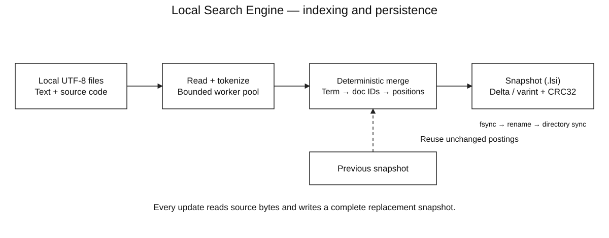
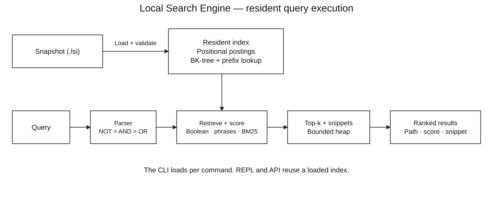
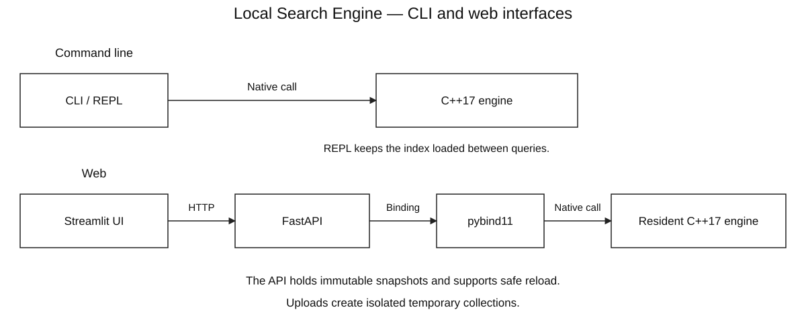

# Local Search Engine

A C++17 **local text search engine** for UTF-8 documents and source code. It builds its own positional inverted index, evaluates Boolean and phrase queries, and ranks matches with BM25. Search is available through the CLI, an interactive REPL, and an optional Streamlit + FastAPI interface.

**Positional inverted index · BM25 · recursive-descent parser · BK-tree fuzzy search · prefix lookup · bounded top-k heap · incremental snapshots**

The retrieval algorithms are implemented in the C++ core. The web API calls that same core through pybind11 and retains an immutable index in memory, so each search does not spawn a CLI process. Services bind to loopback by default.

## Architecture

### Indexing and persistence



Parallel workers read and analyze files into per-document term positions. A deterministic merge builds the positional inverted index. Incremental indexing reuses unchanged postings after comparing actual source bytes; each update still reads the source and writes a complete replacement snapshot.

### Retrieval and ranking



A loaded snapshot supplies sorted postings, token positions, a BK-tree and ordered prefix lookup. The parser applies Boolean precedence, retrieval finds eligible documents, and BM25 assigns relevance scores. A size-k heap retains the best results before final sorting and snippet generation.

### CLI and web interfaces



Both interfaces use the same C++17 implementation. The CLI loads a snapshot for each command; the REPL reuses it across queries. FastAPI calls the native engine through pybind11 and holds immutable snapshots in memory. Streamlit sends HTTP requests to that API. Uploads create isolated temporary collections.

### A search from query to results

1. Load and validate a saved `.lsi` snapshot, or reuse the resident snapshot in the REPL/API.
2. Tokenize the query and evaluate its expression with a recursive-descent parser using **NOT > AND > OR** precedence.
3. Resolve terms, prefix ranges and fuzzy expansions against the dictionary. Intersect, union or complement sorted document lists; phrases additionally check token positions.
4. Accumulate BM25 contributions for positive terms. Filters and negated clauses determine eligibility without adding score.
5. Keep at most k results in a bounded heap, order score ties by relative path, then generate snippets and optional term explanations.

[Architecture and correctness](docs/ARCHITECTURE.md) documents the implementation invariants. The three diagrams are separate, text-first SVGs with [editable draw.io sources](docs/DIAGRAMS.md).

## Build

Requirements: C++17, `make` and POSIX filesystem APIs. Python 3 is used for CLI integration tests and synthetic benchmarks; the optional web setup was tested with Python 3.13. The recorded tests and measurements were run on macOS Apple Silicon. Linux/WSL instructions are provided; execution there has not been validated on this development Mac.

On macOS, install compiler tools if needed:

```sh
xcode-select --install
```

Clone and build:

```sh
git clone https://github.com/pigglegiggle/local-search-engine.git
cd local-search-engine
make
```

There are no third-party dependencies for the command-line C++ engine. `make` builds `build/lse`; `Nothing to be done` means it is up to date.

On Ubuntu/Linux, install the build tools first, then clone and build as above:

```sh
sudo apt update
sudo apt install -y build-essential clang git python3 python3-dev python3-venv
```

### Build and run on Windows (WSL2)

From an administrator PowerShell terminal:

```powershell
wsl --install -d Ubuntu-24.04
```

Restart if prompted and complete Ubuntu setup. Run the Linux installation, clone and build commands **inside Ubuntu**. Keep the checkout and Python environment in the Linux filesystem, such as `~/projects/local-search-engine`. Native Windows/MSVC builds are not implemented because the engine uses POSIX APIs including `flock` and `fsync`.

The [complete Windows walkthrough](docs/HOW_TO_RUN.md#windows-setup-wsl2) covers WSL checks, browser access, Windows-drive paths, web setup and benchmark portability.

## Try the included corpus

```sh
make demo
./build/lse repl --index build/demo.lsi --explain
```

The demo indexes only `examples/corpus`, then searches for `"memory allocation" OR scheduler~1`. It starts with five documents, 120 dictionary terms and 161 tokens. Ranked results include relative paths, BM25 scores, contextual snippets and per-term contributions. Timings and update counters vary by run.

The REPL keeps that index loaded. Enter a query such as `cache OR memory`; enter `:quit` to exit. Searches use a saved snapshot, so source edits become searchable after reindexing.

## Index your own files

```sh
./build/lse index ./examples/corpus --index build/my-notes.lsi --threads 4
./build/lse search '"memory allocation"' --index build/my-notes.lsi --explain
./build/lse search '(cache OR memory) NOT ext:cpp' --index build/my-notes.lsi
./build/lse search 'sched* OR memry~1' --index build/my-notes.lsi --json
./build/lse stats --index build/my-notes.lsi
./build/lse verify --index build/my-notes.lsi
```

Replace `./examples/corpus` with your folder; quote paths containing spaces. The first command recursively reads supported text/source files. `search` queries that snapshot, `stats` reports index statistics, and `verify` reconstructs postings from stored content and checks every token position.

Run the same `index` command after editing files. It detects additions, changed content and removals while reusing unchanged positional postings. Content comparison uses actual bytes. If an old index is damaged or incompatible, indexing refuses to overwrite it silently; add `--rebuild` to explicitly replace it from source files. A failed rebuild preserves the old snapshot.

The default snapshot is `.local-search/index.lsi` relative to the **current working directory**. Use `--index` consistently when choosing another location. See [How to run](docs/HOW_TO_RUN.md) for the full CLI and upload walkthrough.

## Web UI and API


The screenshot uses the included demo corpus.

```sh
make web-setup
make web
```

Open [Local Search](http://127.0.0.1:8501) or [interactive API docs](http://127.0.0.1:8000/docs). Ctrl+C in the launcher terminal stops both services. After setup, `make web` is enough. Use `LSE_INDEX=/absolute/path/to/index.lsi make web` to serve another prebuilt index. See [How to run](docs/HOW_TO_RUN.md) for corpus selection, snapshot reload, timing boundaries, and API examples.

Endpoints: `GET /health`, `GET /stats`, `GET /search?q=memory&k=10&explain=true`, `POST /reload`, and `POST /collections` for multipart uploads. API queries use the native engine, with HTTP validation and snapshot-safe reload. `make web-test` runs HTTP/native parity and Streamlit interaction tests. This is a local service; multi-user authorization and public deployment controls are not implemented.

The UI uses standard Streamlit widgets and styling. Upload UTF-8 text/source files, click **Index uploaded files**, then search that temporary collection. Switch back to the default collection in the sidebar. Uploads do not overwrite the default index. Limits: 50 files, 8 MiB per file, 32 MiB total; PDF/Word/images are not supported. Uploaded collections are temporary, limited to four recently used collections, and cleaned up when the API stops.

## Query language

| Query | Meaning |
|---|---|
| `memory allocation` | Both terms; implicit AND |
| `memory AND allocation` | Explicit AND |
| `cache OR scheduler` | Either term |
| `memory NOT ext:log` | Memory, excluding `.log` documents |
| `(cache OR memory) AND scheduler` | Parenthesized expression |
| `"memory allocation"` | Adjacent, ordered analyzed tokens |
| `"very very fast"` | Repeated terms in a phrase are supported |
| `sched*` | Dictionary terms starting with `sched` |
| `memry~1` | Words within one Levenshtein edit |
| `schedulr~2` | Words within two edits |
| `ext:cpp` | Extension filter, case-insensitive; `ext:.cpp` also works |
| `path:notes/` | Case-insensitive substring of relative path |
| `NOT cache` | Complement, including empty documents |

Precedence is **NOT > AND > OR**. Operators must be uppercase. Quote the entire query in your shell. Unquoted query atoms must analyze to one word; quote hyphenated or punctuated text, e.g. `"write-through"`. Phrases are token sequences, not byte substrings: punctuation and whitespace are separators, so `"memory allocation"` also matches `memory, allocation`.

Filters do not add relevance points. Positive terms contribute BM25; repeated terms or overlapping OR clauses can contribute more than once. Fuzzy expansion weights each matching term by `1 / (1 + edit_distance)`. Phrase matching filters candidates without an additional phrase bonus. A document matching only a filter or a negated clause has score zero. Ties use relative path order, deterministically.

`--explain` shows term frequency (tf), document frequency (df), and each BM25 contribution. `--json` exposes query, hit count, expansion terms, paths, scores, snippets, and optional score explanations for tooling.

## Algorithms and data structures

| Component | Data structure / algorithm | Why it exists |
|---|---|---|
| Index | Ordered dictionary → sorted document postings → sorted token positions | Retrieve relevant documents without scanning every file |
| Boolean retrieval | Two-pointer intersection/union of sorted document IDs | Linear work in the input result-list lengths |
| Query syntax | Recursive-descent parser with bounded nesting | Encode precedence and reject malformed expressions |
| Phrase search | Posting intersection + positional binary searches | Distinguish `memory allocation` from `allocation memory` |
| Ranking | BM25, `k1=1.2`, `b=0.75` | Balance rarity, term-frequency saturation, and document length |
| Prefix expansion | Ordered-map `lower_bound` + contiguous prefix range | Avoid scanning unrelated vocabulary entries |
| Typo tolerance | BK-tree + codepoint Levenshtein dynamic programming | Prune vocabulary candidates using triangle inequality |
| Top-k | Size-k heap with deterministic tie breaking | Retain the strongest results in `O(M log k)` selection work |
| Persistence | Delta encoding + unsigned varints + CRC32 | Compact integer gaps and detect accidental corruption |
| Indexing | Bounded worker pool + deterministic merge | Parallelize file reading/tokenization without nondeterministic index output |

The BK-tree has a worst case of visiting the whole vocabulary; it is not guaranteed logarithmic. The search evaluator materializes Boolean intermediate results, and explanations are collected before top-k selection. These are explicit implementation tradeoffs, not claims of web-scale retrieval.

See [architecture](docs/ARCHITECTURE.md), [How to run](docs/HOW_TO_RUN.md), and [benchmark methodology](docs/BENCHMARKS.md).

For the measured 3,000–20,000-document scaling runs, real CPython corpus, large-file test, memory observations and raw data, read the [performance report](docs/PERFORMANCE_REPORT.md).

## Persistence and filesystem behavior

- Writer lock prevents two CLI indexing processes from modifying the same index concurrently. Readers do not acquire the writer lock.
- A new index is written to a unique temporary file in the destination directory, flushed with `fsync`, and atomically renamed into place. The containing directory is then synced. If directory sync fails after rename, the CLI reports that the replacement already occurred.
- Readers open either the old complete snapshot or the new complete snapshot. A failed scan does not commit a partially rebuilt index.
- Format/version, payload length, CRC32, allocation bounds, sortedness, paths, document references, and position ranges are validated during load. `verify` additionally rebuilds the expected postings from stored content and compares every position.
- Index files contain **full source text** for offline snippets. Treat them as sensitive as the originals; temporary index files are created with owner-only permissions. CRC32 is an accidental-corruption check, not authentication or encryption.
- Symlinks are not followed. Skipped directories: `.git`, `.local-search`, `node_modules`, `build`, `dist`, `__pycache__`, `.venv`.
- Unsupported extensions are ignored. Binary, invalid UTF-8, and oversized supported files are skipped with warnings. If a formerly indexed file becomes invalid or oversized, it is removed from the next snapshot. Traversal/read errors fail the build instead of silently deleting unreadable documents.
- Files are read individually; this is not a coordinated filesystem snapshot. For reproducible builds, index a directory that is not being edited concurrently.

## Scope and limits

- Supports UTF-8 text/source files, including `.txt`, `.md`, `.cpp`, `.hpp`, `.cc`, `.c`, `.h`, `.py`, `.rs`, `.go`, `.java`, `.json`, `.yaml`, `.yml`, `.toml`, `.csv`, `.log`, `.sh`, `.sql`, `.js`, `.ts`, `.tsx`, `.jsx`, `.html`, `.css`, `.rst`, `.markdown`.
- ASCII case folding; common non-ASCII scripts retained. **No Thai word segmentation, Unicode normalization, full Unicode case folding, stemming, PDF extraction, or OCR.** Thai without spaces is treated as a continuous token. `café` is distinct from `cafe` except when fuzzy search is requested; uppercase accented text is not folded.
- Defaults: 8 MiB per file (`--max-file-mb 1..64`), at most 100,000 supported candidate files, 256 MiB of corpus content, and 512 MiB serialized payload. Runtime memory can be substantially larger than source bytes because text, tokens, maps, postings, and snapshots coexist.
- Query limit: 4,096 bytes, 256 lexical elements, 64 nesting levels, 32 words per phrase, 128 codepoints per standalone query word, 128 prefix/fuzzy expansion terms, top-k between 1 and 10,000. Overbroad expansions fail explicitly instead of returning incomplete results.
- Updating reuses unchanged postings but still reads source content, remaps document IDs, constructs the new dictionary/BK-tree, and rewrites the complete snapshot. This is incremental analysis, **not** in-place segment compaction.
- Index loading reads and structurally validates the full index and builds a BK-tree. Repeated CLI searches should use `repl` to amortize startup cost. The optional FastAPI service holds a resident snapshot and Streamlit provides its UI. There is no file watcher or multi-machine index.

## Tests and measurements

```sh
make test
make sanitize
make benchmark
```

The C++ suite includes seeded differential tests against independent brute-force document predicates, exhaustive BK-tree comparisons, score arithmetic, Unicode, parser errors, and bounded random query fuzzing. Integration tests cover full/incremental byte equivalence, persistence, corruption, writer locking, concurrent readers, skipped files, and failure preservation.

The benchmark generates a reproducible synthetic corpus and checks top-10 IDs, BM25 scores, and match totals against a pre-tokenized scan baseline **before timing**. It reports resident-memory query p50/p95, build/reindex wall time, index size, load time, and separate fresh-process CLI timings. Output: `build/benchmark.json`. See the methodology before quoting a speedup.

### Recorded run (20,000 documents)

On 31 October 2026, on Apple M2 / 16 GiB RAM / macOS with Apple Clang 21, using 20,000 synthetic documents / 3.6 million tokens, 12 query workloads, and 360 samples per method:

| Resident-memory query latency | Engine, including snippets | Pre-tokenized scan + BM25 baseline |
|---|---:|---:|
| p50 | 0.388 ms | 4.435 ms |
| p95 | 2.158 ms | 22.125 ms |

Top-10 ranking, scores, and total matches agreed for all benchmark workloads. First indexing took 3.02 seconds end to end; an unchanged reindex took 2.07 seconds (one sample each). Fresh search-process median was 437 ms across five runs, including loading. The baseline omits snippets and explanations; this is a comparison with a straightforward resident token-scan ranker, not with another search product.

The real CPython corpus (2,291 indexed files / 43.04 MiB) had pooled resident p50/p95 of 1.94/2.94 ms, but native index loading took a median 13.68 seconds. A 16 MiB single-document test reached 1.25 GiB process peak RSS. These are material current limitations. See the [full report, methodology and raw observations](docs/PERFORMANCE_REPORT.md), including the 50,000-file run blocked by insufficient disk space.

## Repository map

```text
include/lse/engine.hpp   Public types and API
src/engine.cpp          Analysis, query parsing, retrieval, ranking, indexing
src/storage.cpp         File format, validation, locking, atomic replacement
src/main.cpp            CLI, REPL, JSON output, semantic verification
tests/unit.cpp          Differential and algorithm tests
tests/integration.py    Black-box filesystem/persistence tests
tests/benchmark.cpp     In-memory ranked retrieval comparison
scripts/benchmark.py    Corpus generator and measurement orchestration
scripts/benchmark_real.py CPython, incremental-update and large-file measurements
bindings/python.cpp     pybind11 bridge to resident C++ snapshots
web/                    FastAPI service, Streamlit UI and HTTP client
requirements-web.txt    Pinned optional web dependencies
examples/corpus/        Small inspectable demo corpus
docs/                   Run guide, architecture, benchmarks and UI screenshot
```
