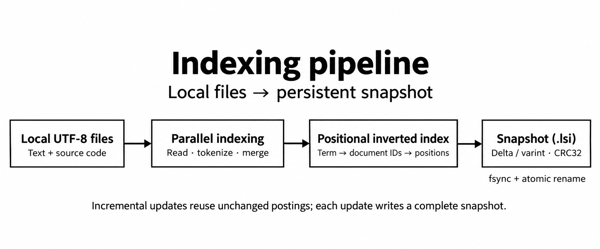
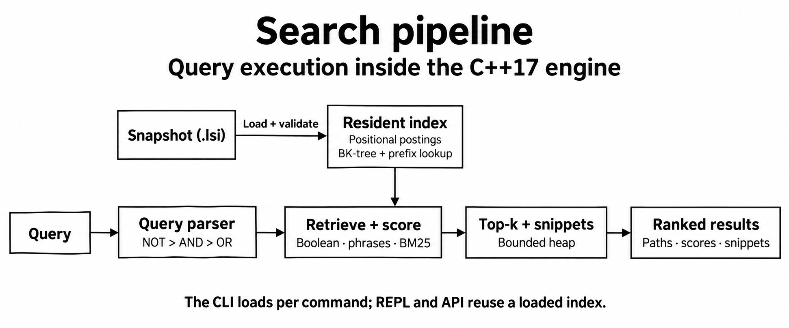
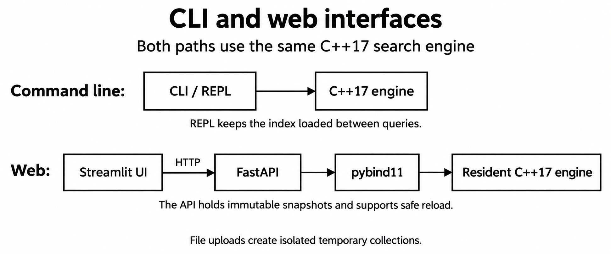

# Local Search Engine

A C++17 search engine for local UTF-8 text and source files. The retrieval algorithms are implemented here, rather than delegated to a search library. Runs on macOS (Apple Silicon or Intel) and POSIX systems with a C++17 compiler.

Windows users can follow the [WSL2 setup](#build-and-run-on-windows-wsl2) below. Native Windows/MSVC builds are not implemented.

**Positional inverted index · BM25 · Boolean query parser · phrase matching · BK-tree fuzzy search · prefix search · bounded top-k heap · incremental snapshots**

Use the command-line application or the optional **Streamlit + FastAPI interface**. Both use the same C++ engine. The web API holds an immutable native index in memory through pybind11 instead of spawning a CLI process for each search. Services bind to loopback by default.

For a complete installation, CLI, upload and API walkthrough, see [How to run](docs/HOW_TO_RUN.md).

## Architecture

### Indexing

Parallel readers tokenize local files and merge positional postings. Updates reuse unchanged postings and atomically replace the saved snapshot.



### Search

The engine loads and validates a snapshot, then uses its resident index for Boolean/phrase retrieval, BM25 ranking and top-k results. The REPL and API reuse the loaded index across queries.



### CLI and web interfaces

Both interfaces use the same C++17 core. The web service calls it through pybind11 and keeps immutable snapshots in memory, with isolated temporary collections for uploads.



See [architecture and correctness](docs/ARCHITECTURE.md) for invariants, algorithms and storage guarantees.

## Web UI and API


The screenshot uses the included demo corpus.

```sh
make web-setup
make web
```

Open [Local Search](http://127.0.0.1:8501) or [interactive API docs](http://127.0.0.1:8000/docs). Ctrl+C in the launcher terminal stops both services. After setup, `make web` is enough. Use `LSE_INDEX=/absolute/path/to/index.lsi make web` to serve another prebuilt index. See [How to run](docs/HOW_TO_RUN.md) for corpus selection, snapshot reload, timing boundaries, and API examples.

Endpoints: `GET /health`, `GET /stats`, `GET /search?q=memory&k=10&explain=true`, `POST /reload`, and `POST /collections` for multipart uploads. API queries use the native engine, with HTTP validation and snapshot-safe reload. `make web-test` runs HTTP/native parity and Streamlit interaction tests. This is a local service; multi-user authorization and public deployment controls are not implemented.

The UI uses standard Streamlit widgets and styling. Upload UTF-8 text/source files, click **Index uploaded files**, then search that temporary collection. Switch back to the default collection in the sidebar. Uploads do not overwrite the default index. Limits: 50 files, 8 MiB per file, 32 MiB total; PDF/Word/images are not supported. Uploaded collections are temporary, limited to four recently used collections, and cleaned up when the API stops.

## Build and run on macOS

Install Apple's command-line tools if needed:

```sh
xcode-select --install
```

From this project directory:

```sh
make
make demo
./build/lse repl --index build/demo.lsi --explain
```

Index a directory you choose, then search:

```sh
./build/lse index ./examples/corpus --index build/my-notes.lsi --threads 4
./build/lse search '"memory allocation"' --index build/my-notes.lsi --explain
./build/lse search '(cache OR memory) NOT ext:cpp' --index build/my-notes.lsi
./build/lse search 'sched* OR memry~1' --index build/my-notes.lsi --json
./build/lse stats --index build/my-notes.lsi
./build/lse verify --index build/my-notes.lsi
```

Run `index` again after editing source files. It detects content changes, adds new files, removes missing files, and reuses unchanged positional postings. Content comparison uses actual bytes, not modification times or a collision-prone content hash.

If an existing index is damaged or incompatible, `index` refuses to overwrite it silently. Use `./build/lse index <folder> --index <file> --rebuild` to explicitly create a complete replacement from source files. A failed rebuild still leaves the old snapshot in place.

The default index location is `.local-search/index.lsi` relative to the **current working directory**, not the corpus directory. Use `--index` consistently if you select another location. Search uses the saved snapshot; rerun `index` to see changes. `:quit` exits the interactive session.

## Build and run on Windows (WSL2)

Use **WSL2 with Ubuntu** to run the Linux build on Windows. The engine requires POSIX APIs such as `flock`, `fsync` and `unistd.h`; installing a Windows C++ compiler alone is insufficient. The instructions below target Ubuntu 24.04. WSL execution has not been tested on the development Mac; the recorded test and benchmark results are from macOS.

### 1. Install WSL2

On Windows 11, or Windows 10 version 2004/build 19041 or later, open **PowerShell as Administrator**:

```powershell
wsl --install -d Ubuntu-24.04
```

Restart Windows if prompted, launch **Ubuntu 24.04**, and create the requested Linux username/password. If WSL is already installed, use `wsl --list --online` to check the available distribution names. Microsoft's [WSL installation guide](https://learn.microsoft.com/en-us/windows/wsl/install) covers prerequisites and installation troubleshooting.

Check the installed distribution from PowerShell:

```powershell
wsl --list --verbose
```

Its `VERSION` column should be `2`. If it is `1`, convert that distribution with `wsl --set-version Ubuntu-24.04 2` (use the exact installed name).

### 2. Install Linux tools and clone the project

Run the remaining build and application commands **inside the Ubuntu terminal**, not directly in PowerShell or Command Prompt:

```bash
sudo apt update
sudo apt install -y build-essential clang git python3 python3-dev python3-venv

mkdir -p ~/projects
cd ~/projects
git clone https://github.com/pigglegiggle/local-search-engine.git
cd local-search-engine
```

Keep the checkout, virtual environment and saved indexes in the Linux filesystem, such as `~/projects`, for Linux filesystem semantics and better file-operation performance. See Microsoft's [filesystem guidance](https://learn.microsoft.com/en-us/windows/wsl/filesystems). Create `.venv` inside WSL; do not reuse a Windows/macOS virtual environment or a compiled native module from another operating system.

### 3. Build and try the CLI

```bash
make
make demo
./build/lse search '"memory allocation"' --index build/demo.lsi --explain
./build/lse repl --index build/demo.lsi --explain
```

Enter `:quit` to exit the REPL. All query syntax and CLI examples elsewhere in this README also apply inside WSL.

### 4. Start the web UI

```bash
make web-setup
make web
```

The setup creates a Linux Python virtual environment, installs the pinned dependencies and compiles the native C++ binding. Keep that terminal open, then open these addresses in your **Windows browser**:

- UI: <http://localhost:8501>
- API docs: <http://localhost:8000/docs>

WSL supports accessing Linux services from Windows using `localhost`; see Microsoft's [networking guide](https://learn.microsoft.com/en-us/windows/wsl/networking). If the page does not open, check that both services started and their ports are free; WSL networking/firewall configuration can also affect access. Press **Ctrl+C in Ubuntu** to stop both services. On later runs, use `make web` again.

### 5. Index files stored on Windows

Windows drives appear under `/mnt` in WSL. For example, `C:\Users\YourName\Documents\my-notes` becomes `/mnt/c/Users/YourName/Documents/my-notes`. Replace `YourName` and the folder with your actual path:

```bash
./build/lse index "/mnt/c/Users/YourName/Documents/my-notes" \
  --index build/windows-notes.lsi --threads 4
./build/lse search 'memory OR cache' --index build/windows-notes.lsi

# Start the UI with this snapshot instead of the demo collection.
LSE_INDEX="$PWD/build/windows-notes.lsi" make web
```

Stop an existing launcher before starting another. Reindex after source edits, then click **Reload index** in the UI. Keep the snapshot under the Linux checkout even when reading source files from a Windows drive. For reproducible performance measurements, copy the corpus into the Linux filesystem too; `/mnt/c` timings include cross-filesystem costs.

### 6. Verify the WSL build

```bash
make test
make web-test
make benchmark
```

`web-test` requires `web-setup` first. The synthetic benchmark uses temporary files and keeps its JSON results in `build/benchmark.json`. The separate `scripts/benchmark_real.py` harness uses macOS `/usr/bin/time -l` and is **not portable to WSL as written**; use the synthetic benchmark on WSL or adapt the memory measurement before running that harness.

## Query language

| Query | Meaning |
|---|---|
| `memory allocation` | Both terms; implicit AND |
| `memory AND allocation` | Explicit AND |
| `cache OR scheduler` | Either term |
| `memory NOT ext:log` | Memory, excluding `.log` documents |
| `(cache OR memory) AND scheduler` | Parenthesized expression |
| `"memory allocation"` | Adjacent, ordered analyzed tokens |
| `"very very fast"` | Repeated terms in a phrase are supported |
| `sched*` | Dictionary terms starting with `sched` |
| `memry~1` | Words within one Levenshtein edit |
| `schedulr~2` | Words within two edits |
| `ext:cpp` | Extension filter, case-insensitive; `ext:.cpp` also works |
| `path:notes/` | Case-insensitive substring of relative path |
| `NOT cache` | Complement, including empty documents |

Precedence is **NOT > AND > OR**. Operators must be uppercase. Quote the entire query in your shell. Unquoted query atoms must analyze to one word; quote hyphenated or punctuated text, e.g. `"write-through"`. Phrases are token sequences, not byte substrings: punctuation and whitespace are separators, so `"memory allocation"` also matches `memory, allocation`.

Filters do not add relevance points. Positive terms contribute BM25; repeated terms or overlapping OR clauses can contribute more than once. Fuzzy expansion weights each matching term by `1 / (1 + edit_distance)`. Phrase matching filters candidates without an additional phrase bonus. A document matching only a filter or a negated clause has score zero. Ties use relative path order, deterministically.

`--explain` shows term frequency (tf), document frequency (df), and each BM25 contribution. `--json` exposes query, hit count, expansion terms, paths, scores, snippets, and optional score explanations for tooling.

## Algorithms and data structures

| Component | Data structure / algorithm | Why it exists |
|---|---|---|
| Index | Ordered dictionary → sorted document postings → sorted token positions | Retrieve relevant documents without scanning every file |
| Boolean retrieval | Two-pointer intersection/union of sorted document IDs | Linear work in the input result-list lengths |
| Query syntax | Recursive-descent parser with bounded nesting | Encode precedence and reject malformed expressions |
| Phrase search | Posting intersection + positional binary searches | Distinguish `memory allocation` from `allocation memory` |
| Ranking | BM25, `k1=1.2`, `b=0.75` | Balance rarity, term-frequency saturation, and document length |
| Prefix expansion | Ordered-map `lower_bound` + contiguous prefix range | Avoid scanning unrelated vocabulary entries |
| Typo tolerance | BK-tree + codepoint Levenshtein dynamic programming | Prune vocabulary candidates using triangle inequality |
| Top-k | Size-k heap with deterministic tie breaking | Retain the strongest results in `O(M log k)` selection work |
| Persistence | Delta encoding + unsigned varints + CRC32 | Compact integer gaps and detect accidental corruption |
| Indexing | Bounded worker pool + deterministic merge | Parallelize file reading/tokenization without nondeterministic index output |

The BK-tree has a worst case of visiting the whole vocabulary; it is not guaranteed logarithmic. The search evaluator materializes Boolean intermediate results, and explanations are collected before top-k selection. These are explicit implementation tradeoffs, not claims of web-scale retrieval.

See [architecture](docs/ARCHITECTURE.md), [How to run](docs/HOW_TO_RUN.md), and [benchmark methodology](docs/BENCHMARKS.md).

For the measured 3,000–20,000-document scaling runs, real CPython corpus, large-file test, memory observations and raw data, read the [performance report](docs/PERFORMANCE_REPORT.md).

## Persistence and filesystem behavior

- Writer lock prevents two CLI indexing processes from modifying the same index concurrently. Readers do not acquire the writer lock.
- A new index is written to a unique temporary file in the destination directory, flushed with `fsync`, and atomically renamed into place. The containing directory is then synced. If directory sync fails after rename, the CLI reports that the replacement already occurred.
- Readers open either the old complete snapshot or the new complete snapshot. A failed scan does not commit a partially rebuilt index.
- Format/version, payload length, CRC32, allocation bounds, sortedness, paths, document references, and position ranges are validated during load. `verify` additionally rebuilds the expected postings from stored content and compares every position.
- Index files contain **full source text** for offline snippets. Treat them as sensitive as the originals; temporary index files are created with owner-only permissions. CRC32 is an accidental-corruption check, not authentication or encryption.
- Symlinks are not followed. Skipped directories: `.git`, `.local-search`, `node_modules`, `build`, `dist`, `__pycache__`, `.venv`.
- Unsupported extensions are ignored. Binary, invalid UTF-8, and oversized supported files are skipped with warnings. If a formerly indexed file becomes invalid or oversized, it is removed from the next snapshot. Traversal/read errors fail the build instead of silently deleting unreadable documents.
- Files are read individually; this is not a coordinated filesystem snapshot. For reproducible builds, index a directory that is not being edited concurrently.

## Scope and limits

- Supports UTF-8 text/source files, including `.txt`, `.md`, `.cpp`, `.hpp`, `.cc`, `.c`, `.h`, `.py`, `.rs`, `.go`, `.java`, `.json`, `.yaml`, `.yml`, `.toml`, `.csv`, `.log`, `.sh`, `.sql`, `.js`, `.ts`, `.tsx`, `.jsx`, `.html`, `.css`, `.rst`, `.markdown`.
- ASCII case folding; common non-ASCII scripts retained. **No Thai word segmentation, Unicode normalization, full Unicode case folding, stemming, PDF extraction, or OCR.** Thai without spaces is treated as a continuous token. `café` is distinct from `cafe` except when fuzzy search is requested; uppercase accented text is not folded.
- Defaults: 8 MiB per file (`--max-file-mb 1..64`), at most 100,000 supported candidate files, 256 MiB of corpus content, and 512 MiB serialized payload. Runtime memory can be substantially larger than source bytes because text, tokens, maps, postings, and snapshots coexist.
- Query limit: 4,096 bytes, 256 lexical elements, 64 nesting levels, 32 words per phrase, 128 codepoints per standalone query word, 128 prefix/fuzzy expansion terms, top-k between 1 and 10,000. Overbroad expansions fail explicitly instead of returning incomplete results.
- Updating reuses unchanged postings but still reads source content, remaps document IDs, constructs the new dictionary/BK-tree, and rewrites the complete snapshot. This is incremental analysis, **not** in-place segment compaction.
- Index loading reads and structurally validates the full index and builds a BK-tree. Repeated CLI searches should use `repl` to amortize startup cost. The optional FastAPI service holds a resident snapshot and Streamlit provides its UI. There is no file watcher or multi-machine index.

## Verification and measurements

```sh
make test
make sanitize
make benchmark
```

The C++ suite includes seeded differential tests against independent brute-force document predicates, exhaustive BK-tree comparisons, score arithmetic, Unicode, parser errors, and bounded random query fuzzing. Integration tests cover full/incremental byte equivalence, persistence, corruption, writer locking, concurrent readers, skipped files, and failure preservation.

The benchmark generates a reproducible synthetic corpus and checks top-10 IDs, BM25 scores, and match totals against a pre-tokenized scan baseline **before timing**. It reports resident-memory query p50/p95, build/reindex wall time, index size, load time, and separate fresh-process CLI timings. Output: `build/benchmark.json`. See the methodology before quoting a speedup.

### Recorded run (20,000 documents)

On 31 October 2026, on Apple M2 / 16 GiB RAM / macOS with Apple Clang 21, using 20,000 synthetic documents / 3.6 million tokens, 12 query workloads, and 360 samples per method:

| Resident-memory query latency | Engine, including snippets | Pre-tokenized scan + BM25 baseline |
|---|---:|---:|
| p50 | 0.388 ms | 4.435 ms |
| p95 | 2.158 ms | 22.125 ms |

Top-10 ranking, scores, and total matches agreed for all benchmark workloads. First indexing took 3.02 seconds end to end; an unchanged reindex took 2.07 seconds (one sample each). Fresh search-process median was 437 ms across five runs, including loading. The baseline omits snippets and explanations; this is a comparison with a straightforward resident token-scan ranker, not with another search product.

The real CPython corpus (2,291 indexed files / 43.04 MiB) had pooled resident p50/p95 of 1.94/2.94 ms, but native index loading took a median 13.68 seconds. A 16 MiB single-document test reached 1.25 GiB process peak RSS. These are material current limitations. See the [full report, methodology and raw observations](docs/PERFORMANCE_REPORT.md), including the 50,000-file run blocked by insufficient disk space.

## Repository map

```text
include/lse/engine.hpp   Public types and API
src/engine.cpp          Analysis, query parsing, retrieval, ranking, indexing
src/storage.cpp         File format, validation, locking, atomic replacement
src/main.cpp            CLI, REPL, JSON output, semantic verification
tests/unit.cpp          Differential and algorithm tests
tests/integration.py    Black-box filesystem/persistence tests
tests/benchmark.cpp     In-memory ranked retrieval comparison
scripts/benchmark.py    Corpus generator and measurement orchestration
scripts/benchmark_real.py CPython, incremental-update and large-file measurements
bindings/python.cpp     pybind11 bridge to resident C++ snapshots
web/                    FastAPI service, Streamlit UI and HTTP client
requirements-web.txt    Pinned optional web dependencies
examples/corpus/        Small inspectable demo corpus
docs/                   Run guide, architecture, benchmarks and UI screenshot
```
